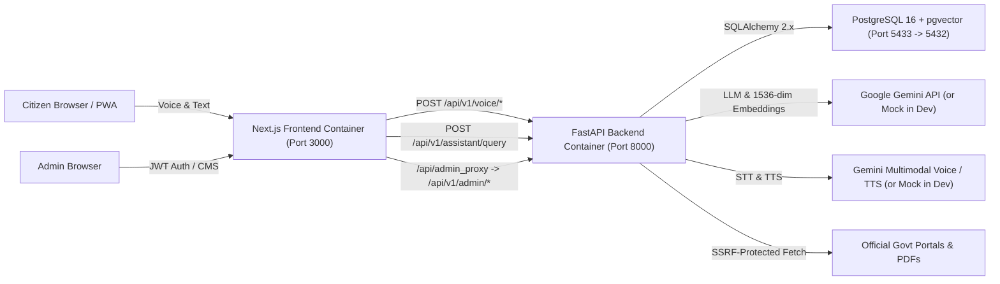
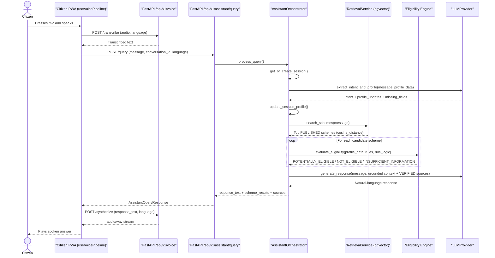
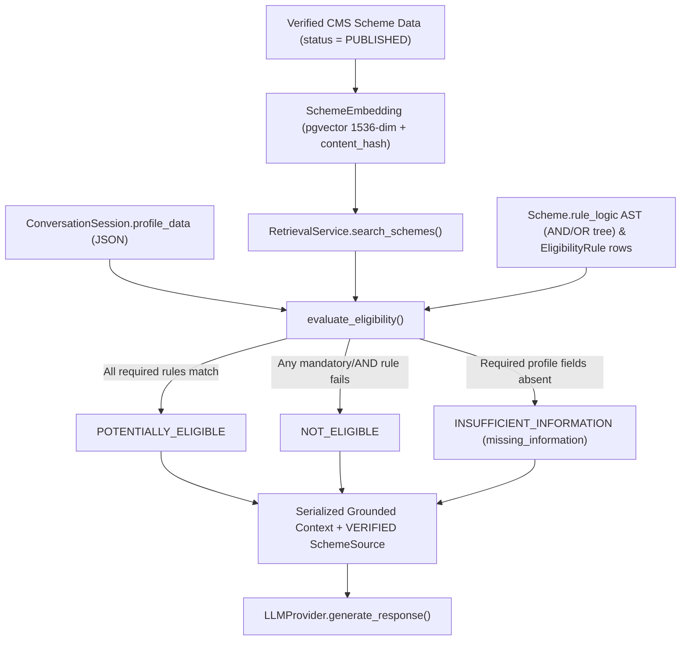
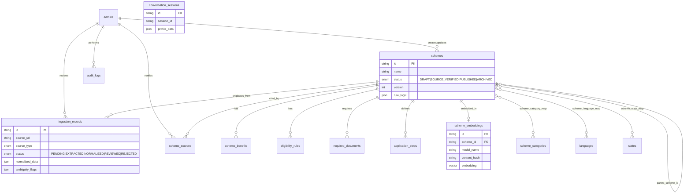

# Sahayak AI - Architecture Diagrams

This document contains the visual architecture, sequence, pipeline, workflow, and database schema diagrams for **Sahayak AI**, reflecting the implemented codebase.

---

## 1. High-Level System & Docker Deployment Architecture

Defined in `docker-compose.yml`, `backend/app/main.py`, and `backend/app/api/v1/api.py`:

---

## 2. End-to-End Voice, RAG & Eligibility Sequence

Implemented across `frontend/src/hooks/useVoicePipeline.ts`, `backend/app/api/v1/endpoints/voice.py`, `backend/app/api/v1/endpoints/assistant.py`, and `backend/app/services/ai/orchestrator.py`:

---

## 3. Deterministic Eligibility & Source-of-Truth Pipeline

Implemented in `backend/app/services/eligibility/engine.py` and `backend/app/services/ai/retrieval.py`:

---

## 4. Human-in-the-Loop Scheme Ingestion Workflow

Implemented in `backend/app/api/v1/endpoints/admin/ingestion.py`, `backend/app/services/ingestion/fetcher.py`, `backend/app/services/ingestion/extractor.py`, and `backend/app/services/ingestion/normalizer.py`:

```mermaid
flowchart LR
    Input["Admin submits URL or PDF"] --> Guard["is_safe_url() SSRF Check (blocks private/loopback IPs)"]
    Guard --> Fetch["fetch_url() / Upload PDF (10MB max)"]
    Fetch --> Extract["extract_html() / extract_pdf() + SHA-256 hash"]
    Extract --> RecExt["IngestionRecord (status = EXTRACTED)"]
    RecExt --> Norm["normalize_scheme_text() (LLM JSON + ambiguity_flags)"]
    Norm --> RecNorm["IngestionRecord (status = NORMALIZED)"]
    RecNorm --> Review["Admin Review & Approve"]
    Review --> Draft["Scheme (status = DRAFT) + IngestionRecord (REVIEWED)"]
    Draft --> Publish["Admin Verification & Publish -> sync_scheme_embedding()"]
```

---

## 5. Core Database Schema (ER Diagram)

Defined in `backend/app/models/scheme_data/models.py`, `backend/app/models/ingestion.py`, and `backend/app/models/admin.py`:

